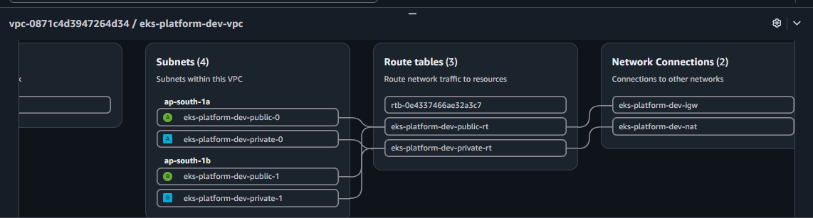
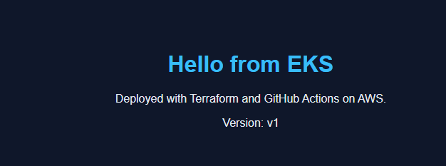
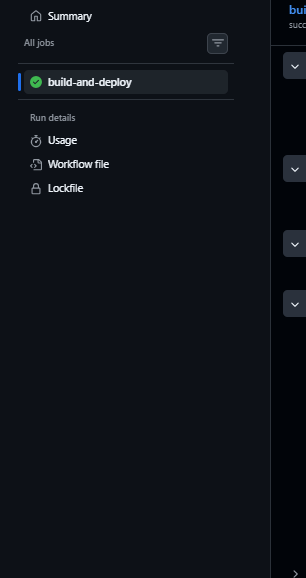

# AWS EKS Platform with Terraform and GitHub Actions

A production-style AWS platform built entirely as code: a custom multi-AZ VPC, an EKS (Kubernetes) cluster and an ECR registry provisioned with Terraform, with a Dockerized web app deployed by a GitHub Actions pipeline that logs in to AWS using OIDC (no stored access keys).

I built this to practise how the pieces of a real DevOps workflow fit together: **code -> container -> infrastructure -> cluster -> automated deployment.**

## What it demonstrates

- **Infrastructure as Code:** a hand-written Terraform VPC module (public and private subnets, internet gateway, NAT gateway, route tables), plus the community EKS module and an ECR repository
- **Remote state:** Terraform state in a versioned, private S3 bucket with state locking
- **Containers:** a hardened nginx image (non-root user) built from a Dockerfile
- **Kubernetes:** Deployment with 2 replicas, readiness and liveness probes, resource limits, and a LoadBalancer Service
- **CI/CD:** GitHub Actions pipelines for infrastructure (plan on pull requests, manual apply/destroy) and for the application (build, push to ECR, deploy, verify rollout)
- **Keyless authentication:** GitHub Actions assumes an AWS IAM role through OIDC, so no AWS keys are stored in GitHub

## Architecture

```
Developer --git push--> GitHub Repo
                          |
            GitHub Actions (OIDC, no stored keys)
              |                         |
         [infra.yml]                [app.yml]
      terraform plan/apply      docker build -> push to ECR
              |                 kubectl apply + rollout check
              v                         |
  +------------------------ AWS (ap-south-1) -----------------------+
  |  S3: Terraform state                                            |
  |  ECR: container images (tagged with the commit SHA)             |
  |  VPC 10.0.0.0/16                                                |
  |   +-- AZ-a --------------+   +-- AZ-b --------------+           |
  |   | public  10.0.1.0/24  |   | public  10.0.2.0/24  | <- IGW    |
  |   |  NAT GW, Load Bal.   |   |  Load Balancer       |           |
  |   | private 10.0.11.0/24 |   | private 10.0.12.0/24 |           |
  |   |  EKS worker node     |   |  EKS worker node     | <- NAT    |
  |   +----------------------+   +----------------------+           |
  +-----------------------------------------------------------------+
User --http--> Load Balancer (public subnet) --> Pods (private subnet)
```

Users reach the load balancer in the public subnets, which forwards traffic to pods running on nodes in the private subnets. The nodes reach the internet (for example, to pull images) only outbound through the NAT gateway.

## Tech stack

Terraform, AWS (VPC, EKS, ECR, S3, IAM), Docker, Kubernetes, GitHub Actions, nginx

## Repository structure

```
devops-eks-platform/
├── app/                 # static web page and Dockerfile
├── k8s/                 # Kubernetes Deployment and Service
├── terraform/
│   ├── bootstrap/       # one-time: state bucket and GitHub OIDC role
│   ├── modules/vpc/     # custom VPC module
│   └── envs/dev/        # dev environment: VPC + EKS + ECR, S3 backend
├── .github/workflows/   # infra.yml and app.yml
└── docs/images/         # screenshots
```

## How it works

1. **Bootstrap (once, from a laptop):** Terraform creates the S3 state bucket and the IAM role that GitHub Actions is allowed to assume.
2. **Infrastructure:** `terraform apply` in `terraform/envs/dev` builds the VPC, the EKS cluster with a managed node group in the private subnets, and the ECR repository.
3. **Deployment:** on every push that changes `app/` or `k8s/`, the `app` workflow builds the image, tags it with the Git commit SHA, pushes it to ECR and rolls it out to the cluster. The job fails if the new pods do not become healthy.
4. **Teardown:** the Kubernetes Service is deleted first, then `terraform destroy` removes everything else.

## Run it yourself

**Prerequisites:** an AWS account, AWS CLI configured, Terraform 1.10 or newer, kubectl, Docker, and a GitHub repository.

```bash
# 1. Bootstrap (once)
cd terraform/bootstrap
terraform init
terraform apply -var="github_repo=<your-github-user>/devops-eks-platform"

# 2. Put the bucket name from the output into terraform/envs/dev/backend.tf
# 3. Add the role ARN from the output as the GitHub secret AWS_ROLE_ARN
#    (the app workflow currently has the ARN written in directly; see the limitations below)

# 4. Build the infrastructure
cd ../envs/dev
terraform init
terraform apply

# 5. Connect to the cluster and deploy
aws eks update-kubeconfig --name eks-platform-dev --region ap-south-1
kubectl get nodes
# then push a change under app/ to trigger the app workflow, or run it from the Actions tab

# 6. Tear down (important: delete the Service first)
kubectl delete -f k8s/service.yaml
kubectl delete deployment app
cd terraform/envs/dev && terraform destroy
```

**Cost note:** EKS is not free tier. While everything runs it costs roughly 0.30 to 0.35 USD per hour (control plane, NAT gateway, two worker nodes, load balancer). I built the environment for each session and destroyed it at the end.

## Screenshots

| | |
|---|---|
| VPC resource map |  |
| Live application |  |
| Green pipeline run |  |

## Problems I ran into and what I learned

- **GitHub changed the OIDC subject format.** The pipeline was refused with "Not authorized to perform sts:AssumeRoleWithWebIdentity". The role trusted `repo:<owner>/<repo>:*`, but the token now carries numeric IDs in the `sub` claim. I found this by printing the token's claims in a small debug workflow, then added the second pattern to the role's trust policy.
- **Free-plan accounts only allow free-tier-eligible instance types.** Worker nodes failed to launch on `t3.medium`. I checked the allowed list with the AWS CLI and switched to `t3.small`.
- **A load balancer created by Kubernetes is not tracked by Terraform.** It blocked `terraform destroy` on the subnets and the VPC. I learned to delete the Service first and to clean up the leftover security group.
- **EKS versions have a support lifecycle.** A cluster on a version past standard support pays about six times more for the control plane, so I pinned a version in standard support. Version 1.35 leaves standard support on 27 March 2027, so it must be bumped before then.
- **Keep installers out of the repository.** Committing the AWS CLI installer folder triggered GitHub secret-scanning alerts on its example keys. They were false positives, but a good reminder to check `git status` before `git add .`.

## Known limitations and next steps

- The pipeline role has `AdministratorAccess`, a shortcut for learning. A real setup would use a least-privilege policy.
- One NAT gateway and one environment, to keep cost low. Production would use one NAT gateway per AZ and separate environments.
- The `app` workflow was verified end to end. The `infra` workflow (plan on pull requests, manual apply/destroy) is written, but the first infrastructure build was run from my laptop, and the role ARN is written directly into `app.yml`.
- The Terraform state for the bootstrap step is kept locally.
- Possible additions: an Ingress with HTTPS and a domain, a Helm chart, image scanning with Trivy, `tfsec` or Checkov on the Terraform, monitoring with Prometheus and Grafana.

## License

MIT